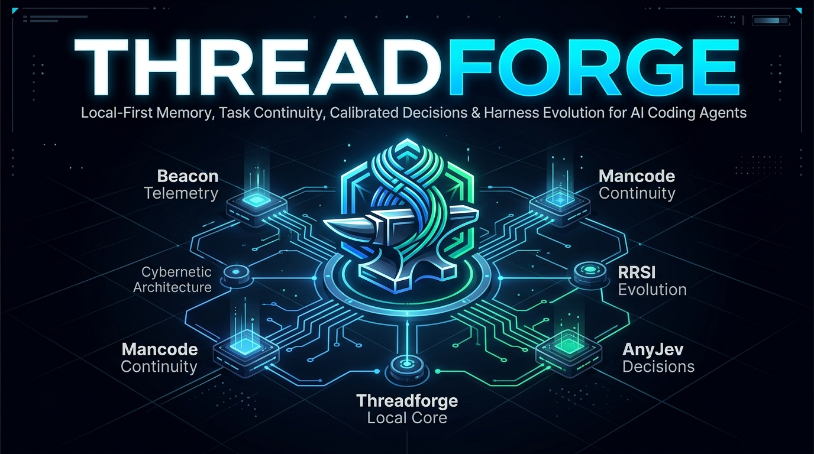
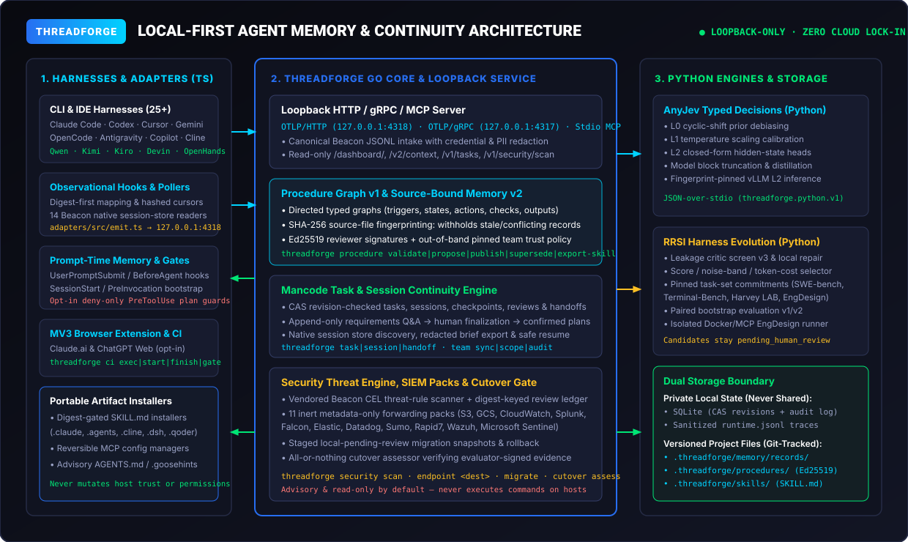
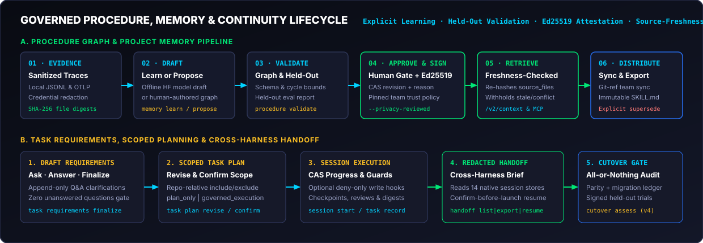
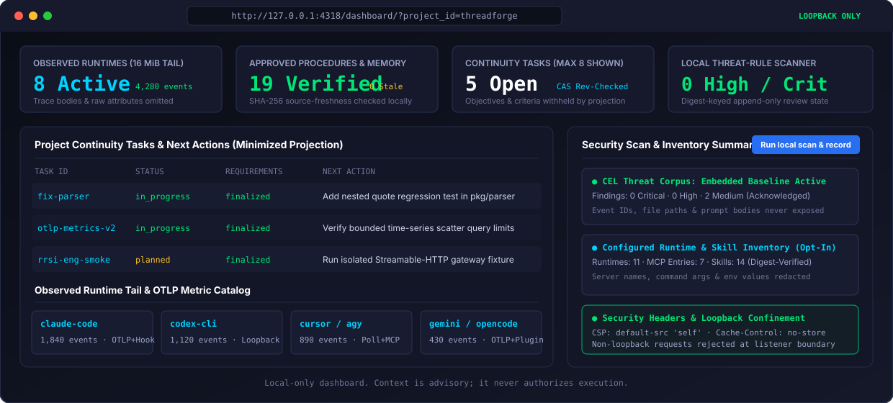

<div align="center">



# Threadforge

**Local-first memory, task continuity, calibrated typed decisions, and procedural learning for AI coding agents—with the goal of reducing repeated failures across harnesses.**

[](LICENSE)
[](go.mod)
[](python/pyproject.toml)
[](adapters/package.json)
[](docs/architecture.md)
[](https://m8ven.ai/mcp/rangow4562-threadforge-ttitus?s=readme)

[Architecture](docs/architecture.md) ·
[Feature Parity Ledger](docs/feature-parity.md) ·
[Host Source Matrix](docs/source-matrix.md) ·
[MCP Setup](docs/mcp.md) ·
[Contributing (`contributor.md`)](contributor.md) ·
[Commit Guide (`commit.md`)](commit.md)

</div>

---

## Overview

**Threadforge** is the planned local-first successor to **Beacon**, **Mancode**, **AnyJev**, and **RRSI**. The target is full documented feature parity before any legacy cutover. This repository is an early implementation, not a feature-complete replacement.

| Pillar | Legacy Origin | Threadforge Capability | Primary CLI / Surface |
| :--- | :--- | :--- | :--- |
| **Telemetry, Security & Memory** | **Beacon** | Loopback OTLP/HTTP & gRPC intake, 25+ host adapter/poller slices, CEL threat-rule scanner, 11 metadata-only SIEM packs, and SHA-256 source-freshness-checked project memory & procedure graphs | `threadforge serve`, `procedure`, `memory`, `security`, `endpoint`, `inventory`, `ci` |
| **Task & Session Continuity** | **Mancode** | CAS revision-checked tasks, append-only requirements Q&A, repository-scoped task plans, 14 native session-store handoff readers, and Ed25519-signed team procedure sync | `threadforge task`, `session`, `handoff`, `team`, `bootstrap` |
| **Calibrated Typed Decisions** | **AnyJev** | L0 cyclic-shift debiasing, L1 temperature scaling, L2 closed-form hidden-state heads, model block truncation, distillation pipeline, and fingerprint-pinned vLLM inference | `threadforge decision calibrate`, `artifact`, `bundle`, `run`, `batch`, `model`, `distill`, `benchmark` |
| **Harness Self-Improvement** | **RRSI** | Leakage critic screening (v3), bounded local repair, score/noise/token-cost candidate selection, pinned benchmark task-set derivation, and paired bootstrap evaluation (v1/v2) | `threadforge evolution screen`, `critic`, `repair`, `select`, `inventory`, `domain-verify`, `evaluate` |

Devin CLI, Devin Desktop, and standalone Senpi have partial observation-only adapters. Run `npm run adapter -- devin ...`, `npm run adapter -- devin-desktop ...`, or `npm run adapter -- senpi ...` from `adapters/`; Senpi installs a self-contained extension, while Devin manages user/project hook configuration. Devin Cloud Agents support reviewed project skills plus local-only `threadforge cloud devin pull|status` telemetry. GCS/raw-trace upload, live host verification, packaging, and cross-harness acceptance remain unverified; see [Devin CLI](docs/devin-cli.md), [Devin Desktop](docs/devin-desktop.md), [Devin Cloud Agents](docs/devin-cloud-agents.md), [Senpi](docs/senpi.md), and the [source matrix](docs/source-matrix.md).

On Windows PowerShell, use `npm.cmd` for adapter examples that forward `--` options (as shown in PowerShell code blocks); the `npm.ps1` shim can consume those flags. POSIX shell examples continue to use `npm`.

---

## System Architecture & Governance Lifecycle

<p align="center">
  
</p>

<p align="center">
  
</p>

---

## Current implementation

- Go CLI with strict, versioned procedure-graph validation and bounded neighborhood rendering.
- Local SQLite proposal/audit store with compare-and-swap revisions and explicit approval gating.
- Human-approved, privacy-reviewed fact/decision/policy records as immutable versioned project files with SHA-256 history chaining.
- Shared procedure files require a locally trusted Ed25519 reviewer identity, explicit project/role grants, an out-of-band-pinned trust policy, and a signature over the exact sanitized graph revision; unsigned or tampered project procedures are withheld. `threadforge team sync pull|push` transfers only these signed, privacy-reviewed project procedure records through a Git ref; it never transfers traces, task/session SQLite state, credentials, branches, or worktrees. Push requires `--expected-revision` and remote CAS; stale snapshots and divergent records require pull/review. See [team authorization and Git-ref procedure sync](docs/team-authorization.md) and [local task handoffs](docs/task-handoffs.md).
- Team scopes can be explicitly frozen with `threadforge team scope decommission`; this blocks continuity writes, shared procedure publication/supersession, and procedure sync while retaining history. Reactivation requires a newly pinned policy for the same organization and a different trusted `team.scope.manage` signing key. Lifecycle events remain append-only and are covered by `threadforge team audit verify`. Local SQLite snapshots, verification, staged restore, and explicit activation into a new copy are available; cross-device Mancode task/claim/handoff transport, authority migration, and recovery remain incomplete. See [team scope lifecycle and local recovery](docs/team-authorization.md#local-sqlite-recovery).
- Explicit local-only `memory learn` drafts from sanitized Beacon event exports; proposals still require held-out validation and human review.
- Human-authored procedure proposals can bind sanitized trace evidence without invoking a model; repository scope is explicit in the draft graph.
- Local task and session continuity with acceptance criteria, revision-checked progress, checkpoints, cross-session handoffs, review/verification records, and explicit read-only HTTP/MCP access.
- `threadforge handoff list` reads the 14 Beacon-documented native session stores locally, read-only, with bounded output and per-store warnings; `threadforge handoff export` builds a bounded, redacted brief from a native store or local runtime log; `threadforge handoff resume` previews a native reopen or brief-based continuation and launches only after confirmation (or explicit `--yes`). Supported TypeScript prompt collectors can emit a metadata-only `session.handoff` link without retaining prompt text. Live runtime compatibility, complete source parity, and cross-harness task/link acceptance remain incomplete. See [session handoff](docs/handoff.md).
- Local AnyJev typed decisions and calibration with immutable, human-reviewed per-question artifacts and native whole-bundle persistence, lifecycle review, explicit observation privacy opt-in, and active-bundle inference.
- AnyJev distillation stages: `decision distill pipeline` composes local DatasetDict export, schema-shaped generation, checkpoint-pinned teacher labeling, teacher/student synthetic and gold feature caches, fit, and same-state OOF soft-target replay. Gold caches contain fit-compatible `H`/`y`/`K`/`layers` arrays. The orchestration is fixture-tested, but no authentic dataset/checkpoint run or held-out acceptance evidence exists yet.
- AnyJev serving benchmark: `decision benchmark pipeline` runs local, fingerprinted depth comparisons through a temporary loopback-only vLLM server and reports accuracy, ECE, fit/decision latency, and spread from caller-provided typed train/test cases. POSIX process-group cleanup requires Linux/WSL. Mock boundaries are tested, but no authentic model/GPU run or independently verified held-out evaluation exists; results are never cutover evidence.
- Local RRSI score/noise/cost selection plus a bounded local critic-feedback repair loop, with opt-in append-only SQLite round/attempt/edit history and integrity reconciliation; recorded choices remain pending human review and no candidate is auto-applied.
- Read-only all-or-nothing cutover assessor that checks parity coverage, host/migration evidence, cross-harness tests, evaluator-signed held-out outcome artifacts, failure-reduction/no-regression results, cost/token budgets, and human approvals without modifying legacy repositories.
- Explicit project bootstrap commands configure MCP or add/remove a checksum-marked, advisory-only continuity block in selected host instruction files; they preserve surrounding content and never change trust or grant execution authority. Live host discovery remains unverified. See [project instructions](docs/instruction-bootstrap.md) and [MCP bootstrap](docs/platform-bootstrap.md).
- Read-only local Beacon threat-rule scan with embedded baseline rules, optional external rules, bounded JSONL input, privacy-minimized findings, and severity gates.
- Explicit metadata-only configured runtime, MCP, and skill inventory via `threadforge inventory scan`; system/managed scans are opt-in and config/skill reads are size-bounded and symlink-safe. Inventory discovery does not imply telemetry capture support.
- Local CI telemetry capture for Claude Code and Codex CLI via `threadforge ci exec`, multi-step `threadforge ci start`/`finish`, or the checked-in GitHub composite action, plus strict local JSONL validation via `threadforge ci validate`; capture uses a loopback receiver, isolated Codex configuration, and disabled prompt logging by default. The action's hosted-runner smoke workflow is not yet verified; forwarding and uploads remain incomplete. See [CI details](docs/ci.md).
- Local loopback HTTP service, JSONL event intake, read-only MCP tools, and bounded migration snapshot/apply/rollback commands.
- OTLP/HTTP and OTLP/gRPC accept logs, traces, and metrics with bounded request sizes and local credential redaction; bounded local metric catalog/time-series queries are available through the API and dashboard, while remote forwarding and signal-specific retention remain incomplete. Claude Code and Gemini CLI have reversible user-level telemetry installers; Codex CLI has a reversible `CODEX_HOME/config.toml` installer and explicit local rollout backfill with digest-only defaults. Codex CLI 0.162.1 now passes an isolated loopback OTLP delivery smoke; approved guidance appeared in its local traces, so Codex capture is not content-free and must remain local unless separately reviewed. Codex rollout parsing and token-attribution reconciliation remain unverified. Gemini also has project MCP access and approved-memory retrieval. See [local OTLP intake and metric queries](docs/otlp.md), [Codex CLI telemetry](docs/codex-cli-telemetry.md), and [rollout backfill](docs/codex-cli-rollouts.md).
- TypeScript adapter contract package with a bounded SDK event emitter that sends only to the loopback intake; Claude Code, Cursor, Codex, Antigravity, Qwen Code, Hermes Agent, Kimi Code, Kiro, Muse Code, Oh My Pi, and standalone Senpi have partial metadata-only hook/extension slices, and Cline, OpenCode, and OpenClaw have partial plugin slices. Cline now has a standalone package builder for native project installation; its older absolute-source wrapper remains a local-development option. Cline CLI 3.0.73 installed and imported the generated package in a disposable project, but the host agent loop did not invoke callbacks in that smoke. Approved procedure skills have digest-gated project installers for Claude Code, Command Code, Cline, Copilot, Codex, Cursor, Gemini CLI, Antigravity, OpenCode, OpenHands, Kimi Code, ZCode, DeepSeek Harness, and Qoder CLI; Command Code installs under `.commandcode/skills/`, while Qoder also has a separate explicit slash-command installer for `.qoder/commands/`. Hermes only prints a manually merged YAML hook fragment and does not alter hook consent. None is marked host-supported before live callback/model/task and end-to-end acceptance; Command Code's isolated CLI discovery smoke is documented in [Command Code integration](docs/command-code.md).
- Goose has print-only local OTLP/HTTP config guidance, read-only config/environment/event-log status and recent-event validation, a bounded read-only local session-history poller, and a reversible advisory project instruction target at `.goosehints`. History defaults to digest-only events with explicit capped text opt-in; the fixture-tested schema-v17 reader is not yet verified against an installed Goose host. Goose hooks are deliberately not generated because the documented blocking-hook response could affect policy behavior; live `.goosehints` discovery/use remains unverified. See [Goose OTLP guidance](docs/goose-otel.md), [Goose local history](docs/goose-history.md), and [project instruction bootstrap](docs/instruction-bootstrap.md).
- Cline has a partial digest-first CLI/SDK callback mapper, a self-contained local package build and selected CLI install smoke, bounded local history polling for task/session/Kanban/VS Code stores, a SHA-256-gated project-skill installer, and a user-global MCP config manager that is not project-memory integration. Cline CLI 3.0.73's isolated config inventory discovered the installed project skill, but no agent/model retrieval was tested. History defaults to digests with explicit capped user/assistant capture; host-triggered callback delivery, model-bound skill use, IDE/JetBrains surfaces, source-format reconciliation, and cross-harness verification remain open. See [Cline adapter](docs/cline.md) and [Cline history](docs/cline-history.md).
- VS Code Copilot Chat has print-only loopback OTLP/HTTP settings guidance and read-only JSONC settings/event-log status; content capture defaults off and no user/org settings or preview hooks are installed. See [VS Code Copilot OTLP guidance](docs/vscode-otel.md).
- Claude Cowork has manual print-only guidance for a separately operated public HTTPS collector. It does not mutate organization settings, handle credentials, receive/relay cloud events, or validate delivery; see [Claude Cowork OTLP guidance](docs/claude-cowork.md).
- Claude Code and Codex CLI have opt-in `UserPromptSubmit` hooks, Gemini CLI has a project `BeforeAgent` hook, and Qwen Code has a project-only `UserPromptExpansion` hook that retrieve approved project memory locally as non-authorizing guidance. Qwen treats the expanded model-bound prompt as an untrusted, transient retrieval query; model-invoked commands may also trigger retrieval. Cursor and Antigravity offer bounded project-wide bootstraps at `sessionStart` and `PreInvocation` respectively. Their task-resume context remains off unless the configured command explicitly selects `--task-id` (optionally `--session-id`) or opts into `--discover-active-task`; Antigravity injects only on invocation 0 and requires exactly one workspace path. Discovery injects task data only for one eligible task in the configured project and withholds task details on ambiguity. Cross-project explicit IDs are withheld, and ambiguous sessions require explicit selection. Stored plan/progress remains advisory and is not a permission gate. Since the host may send injected context to its configured model provider, task injection is disabled unless explicitly configured. Live host activation, trust, actual context use, and cross-harness task completion remain unverified. Gemini and Qwen leave project trust unchanged. Claude Code also has a bounded local JSONL transcript poller and digest-gated project-skill installer; Cloud Agents/GCS is not implemented. See [Claude Code history and memory](docs/claude-code-skills.md), [Codex hooks and memory](docs/codex-hooks.md), [Gemini project memory](docs/gemini-cli.md#project-approved-memory-injection), [Qwen Code memory](docs/qwen-code.md#approved-project-memory-retrieval), [Cursor session-start memory](docs/cursor-memory.md), [Antigravity project memory](docs/antigravity-cli.md#approved-project-memory-at-invocation-start), and [project skills](docs/codex-cli-skills.md).
- `bootstrap instructions plan|install|update|uninstall` can add one reversible, fixed advisory memory block for 16 explicitly selected host IDs, including Command Code, Goose `.goosehints`, and separate Codex ChatGPT desktop, CLI, and IDE IDs grouped onto one `AGENTS.md`. It groups shared `AGENTS.md` targets and separately manages Claude, Gemini, Qwen, and GitHub Copilot instruction files; it never adds host trust, commands, skills, MCP, or execution authority. Native discovery and prompt-time use remain unverified. See [instruction bootstrap](docs/instruction-bootstrap.md).
- Reuse/license inventory and a feature-parity ledger; remaining product capabilities are explicitly marked incomplete.
- Optional Claude Code, Qwen Code, and GitHub Copilot CLI task-plan hooks can deny selected direct file writes outside a confirmed task scope; they never emit an allow decision, do not sandbox shell/MCP operations, and remain defense-in-depth only. GitHub documents Copilot command-hook timeouts as always fail-open, including `preToolUse`. See [Copilot CLI task-plan gate](docs/copilot-cli-plan-gate.md), [Claude Code plan gate](docs/claude-code-plan-gate.md), and [Qwen Code plan gate](docs/qwen-code.md#best-effort-deny-only-task-plan-guard).
- Gemini CLI has a project-only `BeforeTool` deny-only task-plan gate for direct `write_file` and `replace` tools. It is locally tested but not yet verified in an installed Gemini denial smoke; hook failures may fail open, and shell/MCP effects are outside its scope. See [Gemini CLI plan gate](docs/gemini-cli.md#project-task-plan-gate).

---

## Local Dashboard & Loopback Service

<p align="center">
  
</p>

---

## Local development

The Go core requires Go 1.25 or newer. From the repository root:

Run `./test.ps1` on Windows to execute Go tests/vet, Python tests/compile checks and sdist-to-wheel package smoke, TypeScript adapter tests, an npm adapter-tarball contents audit, browser-extension checks, and vendored Beacon Go contract tests in one pass. When the required local CLIs are installed, it also runs the no-model skill/command smoke: OpenCode 1.18.31 skill/MCP discovery and project-plugin factory loading via `session list` are checked alongside Gemini/Codex discovery; ZCode, DeepSeek Harness, and Qoder CLI are checked only for installer path/digest behavior. The OpenCode check does not verify plugin hook delivery. Optional host checks are explicitly marked skipped when prerequisites are absent. The script continues after unavailable tools or failed suites, reports every blocked/failed check, and exits nonzero unless every required check passes. This is an internal verification gate; it does not imply full parity or cutover approval. Run the host smoke directly with `cd adapters; npm run test:installed-skills` and the npm payload audit with `cd adapters; npm run test:package`.

The GitHub workflow at `.github/workflows/threadforge-tests.yml` runs the required Go, Python, and adapter suites on Ubuntu, Windows, and macOS with SHA-pinned setup actions. Its hosted result remains unverified until the workflow runs in GitHub.

```powershell
go test ./...
go run ./cmd/threadforge version
go run ./cmd/threadforge procedure validate --file examples/procedure-graph.json
go run ./cmd/threadforge procedure fingerprint --root <project-root> --path src/main.go
go run ./cmd/threadforge migrate inspect --product beacon --root <legacy-data-root>
go run ./cmd/threadforge migrate snapshot --product beacon --root <legacy-data-root>
go run ./cmd/threadforge migrate coverage --manifest <local-snapshot-manifest>
```

Run `threadforge serve --project-root <project-root>` and open `http://127.0.0.1:4318/dashboard/` for the local progress view and project-memory retrieval. The service binds OTLP/HTTP on `127.0.0.1:4318` and OTLP/gRPC on `127.0.0.1:4317` by default; pass `--grpc-listen ""` to disable gRPC. Both listeners require loopback IP addresses. With a configured project root, `/v2/context` hashes procedure sources and project-memory v2 evidence files locally, withholds stale memory, and labels legacy source-unbound memory as unverified; caller-supplied hashes do not override local checks. Use `threadforge mcp print-config --project-root <project-root> --command <threadforge-executable> [--format json|toml]` to print a generic stdio MCP configuration fragment; it does not edit host config files. MCP provides `threadforge_project_memory_index` for content-free browsing and `threadforge_project_memory_read_v2` for exact scope/conflict/source-freshness checked reads. Legacy project-memory v1 records remain readable through the v1 tool but are explicitly not source-freshness verified. The adapter package's `bootstrap mcp plan|install|update|uninstall` coordinates managed MCP config for seven selected hosts; see [project bootstrap](docs/platform-bootstrap.md). Codex and Qwen project config can also be installed directly with `mcp install --host codex-cli|qwen-code`; neither setup path changes host project trust. Qwen MCP updates share the settings lock with its project hooks. Existing procedure-only `POST /v1/context` remains available; unified facts/decisions/policies, freshness and conflict states are versioned at `POST /v2/context`.

The project MCP bootstrap accepts eleven host IDs across seven underlying config files; Claude Code, Command Code, and GitHub Copilot CLI share `.mcp.json`, while ChatGPT desktop Codex, Codex CLI, and Codex IDE are aliases for the same `.codex/config.toml` manager. Installed Command Code and GitHub Copilot CLIs list the project server in isolated configuration smokes; agent-run memory-tool use remains unverified. Live desktop/IDE configuration loading also remains unverified.

Task/session continuity remains local and is exposed only through explicit task/session commands and read-only API/MCP queries. For example:

```powershell
threadforge task create --id fix-parser --project-id my-repo --title "Fix parser regression" --objective "Restore nested quote handling" --criterion "Nested quote fixture passes"
threadforge task update --id fix-parser --expected-revision 1 --status in_progress --next-action "Reproduce against the parser fixture"
threadforge session start --id parser-session-1 --task-id fix-parser --harness codex-cli
threadforge task record --id parser-handoff-1 --project-id my-repo --task-id fix-parser --session-id parser-session-1 --kind handoff --summary "Reproduction isolated; add regression test next"
threadforge session update --id parser-session-1 --expected-revision 1 --close --summary "Reproduced the failure" --next-action "Add the regression test"
```

Task records are advisory continuity, not authorization. See [the continuity schema](schema/continuity-v1.schema.json) and [architecture notes](docs/architecture.md).

New tasks begin with draft requirements. Record clarifications and answers with `threadforge task requirements ask|answer`, revise the objective or acceptance-criteria set with `task requirements revise`, and explicitly finalize with a human actor and reason. A governed-execution plan cannot be confirmed until requirements are finalized. Reopening or changing finalized requirements clears any prior plan decision; see the [requirements workflow](docs/requirements.md).

For a durable task plan, print the deterministic scaffold with `threadforge task plan template --id <task-id>`, edit the resulting Markdown, then store it with `threadforge task plan revise --id <task-id> --expected-revision <n> --file <plan.md> [--scope-file <scope.json>]`. A scope file contains repository-relative `include` patterns and optional `exclude` and `modules` arrays; exclusions take precedence, and module labels alone do not define a file boundary. Plan-only and governed-execution decisions are separate audited confirmations (`threadforge task plan confirm ...`) and require the current task revision. Revising content or scope resets the decision and increments both plan version and task revision. These records are planning continuity only: they do not sandbox file access or authorize tools. Optional Claude Code and Qwen Code deny-only PreToolUse guards cover only direct file-write tools, emit no allow decision, and do not constrain shell/MCP effects or close TOCTOU races. Qwen's guard is best-effort and may fail open on host hook errors, so it is not a security boundary. See the [task plan schema](schema/task-plan-v1.schema.json), [Claude plan-gate limits](docs/claude-code-plan-gate.md), and [Qwen plan-gate limits](docs/qwen-code.md#deny-only-direct-file-task-plan-guard).

The portable MCP setup and current host adapter work are documented in [MCP setup](docs/mcp.md). Claude Code, Cursor, Codex, Antigravity, Qwen, Kimi Code, Kiro, Muse Code, Oh My Pi, and standalone Senpi have partial metadata-only command-hook/extension adapters; Antigravity, Qwen, Kiro, Muse, and Senpi support user/project hook configuration scopes, while Kimi Code hooks remain user-scope only and its approved skills have a separate project path. OMP requires an explicit user/project choice. Kiro project hooks use a dedicated file and keep sibling hook files untouched; host execution remains unverified. Muse requires explicit scope and does not use the managed hook slot; its official host contract is incomplete and its live execution remains unverified. OMP and Senpi use hash-owned extension files and digest-only observation; neither is live-verified, and project extensions are executable code, so install only in a trusted project. Senpi's seven observed events do not expose operator approval decisions. OpenCode has a local plugin event adapter with bounded fail-open delivery and owned project plugin/MCP installers. OpenClaw has a partial digest-only plugin plus native OTLP config guidance and local status/validation; session-history import and live compatibility remain incomplete. Project MCP config install/update/uninstall is available for Claude Code, Command Code, Cursor, Antigravity, Gemini CLI, Qwen Code, Codex CLI, and OpenCode with explicit ownership markers; Claude Code and Command Code share `.mcp.json`, Qwen shares its settings lock with hooks/memory, while Gemini's entry explicitly keeps host trust disabled. Command Code project MCP listing and skill discovery are covered by a zero-model installed-CLI smoke, but agent-run tool use is not. Qwen project MCP loading and retrieval remain unverified. Claude Code's user-level OTLP settings are covered in [Claude Code telemetry](docs/claude-code-telemetry.md), with partial integrations documented for [Antigravity](docs/antigravity-cli.md), [Qwen Code](docs/qwen-code.md), [Kimi Code](docs/kimi-code.md), [Kiro](docs/kiro.md), [Muse Code](docs/muse-code.md), [Oh My Pi](docs/oh-my-pi.md), [Senpi](docs/senpi.md), and [OpenClaw Gateway](docs/openclaw-gateway.md). Host-specific adapters for the other runtimes, live contract verification, packaging, session backfill, and full end-to-end injection remain incomplete and are not counted as parity.

Grok Build has partial local observational hooks and `grok sessions status|sync` for bounded local session backfill; prompt/tool data is digest-only by default, project trust is not modified, and live compatibility, full attachment coverage, packaging, and cross-harness retrieval remain incomplete. See [Grok Build hooks](docs/grok-build.md).

OpenCode also has a bounded, project-scoped session-history poller through its CLI export, with hash-only part-state cursors and explicit incompleteness reporting. A no-real-model host smoke verifies list/export and digest-only preview on OpenCode 1.18.31; other versions, full historical coverage, cross-collector reconciliation, and cross-harness outcomes remain unverified. See [OpenCode session history](docs/opencode-history.md).

Claude Code local transcript polling is available through `claude sessions status|sync`, including non-mutating `--print` preview. It remains a partial capture path, not full source parity; the JSONL format/version contract, live host compatibility, Cloud Agents/GCS, and cross-harness acceptance are open. See [Claude Code history](docs/claude-history.md).

GitHub Copilot CLI local session polling is available through `copilot sessions status|sync`; it reads only bounded session `events.jsonl` files, keeps hashed cursors outside Copilot's directory, and omits transcript content by default. Approved procedures can also be installed with `copilot skills install|uninstall` under `.github/skills/`. A separate `copilot prompts install|uninstall` command projects a reviewed procedure to `.github/prompts/*.prompt.md` for manual invocation in supported Copilot IDEs; it does not enable IDE settings or support Copilot CLI prompt files. Discovery and actual use remain unverified. See [Copilot CLI history](docs/copilot-cli-history.md), [Copilot project skills](docs/copilot-skills.md), and [Copilot IDE prompts](docs/copilot-prompts.md).

Cursor local history polling is available through `cursor sessions status|sync` for both `agent-transcripts` files and the read-only global Composer database, with hashed cursors and digest-first mapping. Its project hooks also emit digest-only assistant-response and reasoning events without installing prompt-submission gates or retaining raw text. The Composer schema and transcript formats remain version-sensitive; cloud sessions, live compatibility, and cross-harness acceptance remain incomplete. See [Cursor history](docs/cursor-history.md).

Cursor additionally has a separate opt-in `cursor plan-gate` installer for a fail-closed, direct-`Write`-only task scope check. It does not authorize writes or cover shell/MCP tools, and an installed-host enforcement smoke remains outstanding. See [Cursor task plan gate](docs/cursor-plan-gate.md).

Claude.ai and ChatGPT Web have a partial opt-in browser extension under `adapters/browser-extension`. Capture and both site toggles default off, retention defaults to metadata, and the receiver must be local loopback. The Chromium replay/privacy suite passes, but private vendor API drift, live-site compatibility, signed distribution, Firefox runtime validation, and cross-harness acceptance remain open. See [browser extension setup and limits](docs/browser-extension.md).

For Claude Code Cloud Agents, approved procedures can be exported as immutable, sanitized project skills and deliberately included in the cloud workspace. Cursor projects can use the digest-gated `cursor skills install` command to place the same reviewed export under `.agents/skills/`, or opt into a bounded approved-memory bootstrap at session start. Cursor's session-start hook is not prompt-specific; use its project MCP tools for task-specific retrieval. Threadforge does not upload cloud-session traces or place telemetry credentials in either environment; these are memory-access paths, not cloud telemetry parity. See [Claude Cloud Agents](docs/cloud-agents.md), [Cursor Cloud Agents](docs/cursor-cloud-agents.md), and [Cursor session-start memory](docs/cursor-memory.md).

Migration is a local pending-review workflow with strict semantic converters for a documented allowlist; unsupported formats remain generic, rejected, or unimported, and imported data is never approval or cutover evidence. Host adapters do not yet collect source fingerprints automatically, so untracked procedures are returned as `unverified` and stale procedures are withheld. See [migration limits](docs/migration.md), the [documented host-source matrix](docs/source-matrix.md), and the [feature-parity ledger](docs/feature-parity.md).

The legacy replacement gate is available as `threadforge cutover assess --report <evidence.json> --evidence-root <artifacts-dir> --trusted-evaluators <external-trust.json> --repository-root <clean-checkout>`. It is read-only and currently blocks because full parity, migration reconciliation, cross-harness evidence, held-out evaluations, and approvals have not been completed. Its v4 report requires per-format migration coverage and hashed task-level evaluation trials, recomputes reported metrics, and verifies evaluator attestations against out-of-repository trust keys; see [cutover requirements](docs/cutover.md).

Local telemetry can be scanned with `threadforge security scan --traces <events.jsonl> --min-severity medium --fail-on high` or the dashboard's explicit **Run local scan and record** button. CLI scans and `GET /v1/security/scan` are read-only; the dashboard uses a separate POST that persists only digest-based review state for complete scans. Review transitions are revision-checked and append-audited; review labels never authorize execution. See [security scan limits](docs/security.md).

An optional customer-managed S3/Vector forwarding pack is available with `threadforge endpoint s3 install-pack --bucket <name> --allow-remote-metadata-forwarding`. The generated transform exports only timestamp and allowlisted severity metadata; pack generation is local-only and does not install/start Vector or upload telemetry. Review [forwarding privacy and limits](docs/forwarding.md) before activating the generated config.

An optional CloudWatch Logs/Vector pack is available with `threadforge endpoint cloudwatch install-pack --log-group <name> --allow-remote-metadata-forwarding`. It uses the same metadata-only projection, a fixed non-host-identifying log stream, and never installs Vector or contacts AWS during pack generation; see [forwarding privacy and limits](docs/forwarding.md).

An optional Google Cloud Storage/Vector pack is available with `threadforge endpoint gcs install-pack --bucket <name> --allow-remote-metadata-forwarding`. It exports only the versioned metadata projection from new runtime events; inventory and raw event content stay local. Pack generation does not read credentials or contact Google Cloud; see [forwarding privacy and limits](docs/forwarding.md).

An optional Splunk HEC/Vector pack is available with `threadforge endpoint splunk-hec install-pack --endpoint <https-origin> --allow-remote-metadata-forwarding`. It exports only the versioned metadata projection; the HEC token is supplied externally to Vector and is never read or stored by Threadforge. See [forwarding privacy and limits](docs/forwarding.md).

An optional CrowdStrike Falcon HEC/Vector pack is available with `threadforge endpoint falcon-hec install-pack --endpoint <https-hec-url> --allow-remote-metadata-forwarding`. It wraps the strict metadata-only event in a versioned HEC envelope; the token stays external to Threadforge. See [forwarding privacy and limits](docs/forwarding.md).

Elasticsearch supports explicit-consent Vector, Filebeat, and standalone Elastic Agent packs via `threadforge endpoint elasticsearch install-pack --path vector|filebeat|elastic-agent`. Native shippers read only a separate local metadata file produced by the Vector sanitizer; credentials stay external to Threadforge. Packs include strict mappings, a metadata-only ingest pipeline, templates, ILM retention, and privacy-minimized Kibana views. They also include `endpoint elasticsearch up|down|status` for an opt-in loopback Docker test stack that ingests only a synthetic fixture; image pulls require `--allow-image-pulls`. Compose validation passes, but the Docker Engine/live cluster flow has not been run in this environment. See [forwarding privacy and limits](docs/forwarding.md).

Datadog supports an explicit-consent Vector Logs pack and a metadata-only Datadog Agent bridge: `threadforge endpoint datadog install-pack --path agent --log-path <raw-local-jsonl> --metadata-log-path <new-empty-absolute-jsonl> --allow-remote-metadata-forwarding`. The Agent reads only Vector's separate sanitized file; site/API credentials stay in the Agent's existing global configuration, outside Threadforge. Live Agent validation/delivery and Beacon's raw event-field parity remain unverified or intentionally incomplete. See [forwarding privacy and limits](docs/forwarding.md).

An optional Sumo Logic/Vector pack is available with `threadforge endpoint sumo install-pack --endpoint <https://.../receiver/v1/http> --auth-header --allow-remote-metadata-forwarding`. The non-secret Auth Header URL is included in the pack; the token stays in Vector's directory-secrets backend and is never read by Threadforge. Presigned bearer URLs are rejected. Vector 0.58.0 config validation passes; Sumo delivery and Beacon's upload smoke-test flow remain unverified. See [forwarding privacy and limits](docs/forwarding.md).

An optional Rapid7 InsightIDR/Vector pack is available with `threadforge endpoint rapid7 install-pack --allow-remote-metadata-forwarding --allow-vector-env-interpolation`. The bearer webhook URL remains external to Threadforge; Vector requires its dangerous environment-interpolation option to resolve it. Vector 0.58.0 config validation passes with a synthetic URL, but live Rapid7 delivery is unverified. Beacon's raw-log smoke-test flow is intentionally excluded. See [forwarding privacy and limits](docs/forwarding.md).

An optional Wazuh pack is available with `threadforge endpoint wazuh install-pack --metadata-log-path <absolute-path> --allow-remote-metadata-forwarding`. It writes an inert Vector file transform, Wazuh localfile snippet, and Threadforge metadata-only rules. Wazuh reads a separate sanitized JSONL file, never the raw Threadforge trace. Vector config validation passes; Wazuh runtime and downstream forwarding are unverified. See [forwarding privacy and limits](docs/forwarding.md).

An optional Microsoft Sentinel pack is available via `threadforge endpoint sentinel install-pack`. The default `--path vector` uses the Azure Logs Ingestion API; `--path ama --metadata-log-path <absolute-path>` generates a local flat-JSON metadata sanitizer plus an Azure Monitor Agent Custom JSON Logs DCR; `--path both` generates both alternatives (activate only one for a given event stream to avoid duplicates). Every path is limited to four metadata fields, and the raw runtime log is never configured as AMA input. Vector 0.58.0 validates both Vector configs; Azure deployment, authentication, AMA ingestion, and live forwarding remain unverified. See [forwarding privacy and limits](docs/forwarding.md).

Project memory can be published with an explicit review record, for example:

```powershell
go run ./cmd/threadforge memory publish --project-root . --file examples/project-memory-candidate.json --expected-revision 0 --reviewer <name> --reason <reason> --privacy-reviewed
```

This writes an immutable revision under `.threadforge/memory/records/`. Later edits must use the current expected revision; credentials and unredacted evidence are rejected. For source-bound v2 memory, fingerprint the cited files with `threadforge memory fingerprint --project-root <root> --path <relative-file> [--path <relative-file> ...]`, place the returned path/hash pairs in each evidence item's `source_files`, and use `schema/project-memory-candidate-v2.schema.json`. Publishing recomputes those hashes. Use `threadforge memory read --project-root <root> --project-id <id> --kind <fact|decision|policy> --id <record-id>` for an exact read that checks project scope and source freshness; stale or unavailable source-bound content is withheld. Legacy v1 records are explicitly unverified guidance. `memory get` remains a raw local inspection command and does not check freshness or applicability. See the [project memory contracts](schema/project-memory-candidate-v1.schema.json), [v2 candidate](schema/project-memory-candidate-v2.schema.json), and [approved record schemas](schema/project-memory-v1.schema.json, schema/project-memory-v2.schema.json).

Approved procedure graphs can be published with `threadforge procedure publish --project-root <root> --id <id> --expected-revision <last-published-revision> --identity-key <private-key.json> --privacy-reviewed`. Install the administrator-provisioned, out-of-band-pinned trust policy first; publication signatures bind the sanitized graph revision and are verified before project files can be retrieved. See [team authorization](docs/team-authorization.md).

An approved graph can also be exported as a portable, immutable `SKILL.md` with `threadforge procedure export-skill --project-root <root> --id <id> --privacy-reviewed`. The revisioned artifact is written under `.threadforge/skills/`; this command does not install it into or inject it into any agent harness. It omits evidence, trace references, evaluation details, and reviewer information, and treats the procedure as guidance rather than execution authorization.

When a different approved procedure replaces one, use `threadforge procedure supersede --id <old-id> --by <replacement-id> --expected-revision <n> --actor <reviewer> --reason <reason>`. After publishing the replacement, publish the old graph's withdrawal with `threadforge procedure publish-supersession --project-root <root> --id <old-id> --expected-revision <last-published-revision> --privacy-reviewed`. Retrieval treats the tombstone as authoritative and does not restore an older approved file revision.

To draft a procedure from repeated sanitized Beacon events, run `threadforge memory learn --input <events.jsonl> --project-id <id> --project-root <root> --model-path <local-hf-model>`. `--project-root` binds the draft to bounded fingerprints of applicable files referenced by trace metadata; absolute paths are not sent to the model or stored. Learning is an explicit command and local-only by default. An unavailable model, unsafe input, unavailable requested fingerprints, or invalid model output produces no candidate; a successful result is stored as a draft proposal and still requires held-out evaluation and human approval before retrieval. Omitting `--project-root` retains unbound legacy behavior, which is not source-freshness evidence.

If the lesson is already known, author the draft graph directly and use `threadforge procedure propose --file <draft.json> --trace-input <events.jsonl> --reason <reason>` to attach digest-only sanitized trace evidence without model inference. The graph's `project_id` controls scope; see [the learning workflow](docs/learning.md#human-authored-proposals-without-a-model).

The TypeScript adapter contracts use Node 22 or newer. Gemini telemetry installation and local OTLP behavior are documented in [Gemini CLI integration](docs/gemini-cli.md):

```powershell
cd adapters
npm test
```

Custom SDK integrations can use `adapters/src/emit.ts` to submit validated Beacon-compatible event envelopes to the loopback receiver. For direct OpenAI and Anthropic SDK clients, `@threadforge/adapter-contracts/genai-sdk` wraps supported create calls and reports bounded model, token-usage, duration, and outcome metadata. The adapter does not inspect or emit prompt/output bodies or provider error text; streaming chunks pass through unchanged. The emitter restricts destinations to loopback, caps batches at 100, and uses a bounded timeout; remote forwarding is not enabled. See [Node SDK instrumentation](docs/sdk-instrumentation.md). This does not count as a host-specific hook, plugin, poller, or browser/cloud integration.

Factory Droid has a partial, read-only local history poller (`factory sessions status|sync`) for Beacon-observed session files, with digest-first retention, explicit capped text opt-in, and local-only settings checkpoints. Its installed-host/export compatibility remains unverified; see [Factory history](docs/factory-history.md).

Vercel fx has a partial read-only poller (`fx sessions status|sync`) that observes the manifest's committed watermark and log generation. It is digest-first, only captures prompt/assistant text with bounded explicit opt-in, and remains unverified against an installed fx release; see [fx history](docs/fx-history.md).

Pi Coding Agent has a partial recursive local-history poller (`pi sessions status|sync`) for Beacon-observed JSONL transcripts. It uses hashed cursors and digest-first mapping; only bounded prompt/assistant text is available with explicit opt-in. Pi's installed file contract, live extension capture, and cross-harness acceptance remain unverified; see [Pi history](docs/pi-history.md).

Prime Agent has a partial local-history poller (`prime-agent sessions status|sync`, also `prime`) across its session and session-artifact roots. It maps persistent-IPython activity and hashed subagent relationships with digest-first privacy; live extension/install/discovery and installed-format verification remain incomplete. See [Prime Agent history](docs/prime-agent-history.md).

OpenHands has a partial project hook adapter: `openhands install|update|uninstall --project-root <path>` preserves unrelated `.openhands/hooks.json` entries and installs six async, non-authorizing telemetry hooks. Approved procedure exports can also be installed into project `.agents/skills/` with digest verification; live skill discovery, payload/version compatibility, and portable packaging remain unverified. See [OpenHands adapter](docs/openhands.md).

Windsurf/Cascade can install reviewed project procedures with `windsurf skills install|uninstall` into the shared `.agents/skills/` directory using the expected SHA-256. This changes only project files; live skill discovery and invocation remain unverified. See [Windsurf/Cascade skills](docs/windsurf-skills.md).

Hermes Agent has partial digest-first hooks, a print-only YAML hook fragment (`hermes hooks print-config`), and bounded local-history status/sync (`hermes sessions status|sync`) against its read-only SQLite store. History text is omitted by default and can be included only with an explicit, bounded `--include-content`; Threadforge never modifies Hermes configuration or enables hook consent. Live host/store compatibility remains unverified. See [Hermes adapter](docs/hermes.md).

DeepSeek Harness has a partial digest-first `dsh hook` adapter, bounded native-session poller (`dsh sessions status|sync`), and `dsh skills install|uninstall` for approved project procedures under `.dsh/skills/`. History sync supports versioned JSONL/Zstandard, digest-first events, private hash cursors, preview, capped explicit content opt-in, filters, and watch mode. The live bridge/native-store version contract, Cordis merge, skill GUI/session/subagent behavior, packaging, and cross-harness retrieval remain unverified; see [DeepSeek Harness adapter](docs/deepseek-harness.md) and [project skills](docs/deepseek-harness-skills.md).

The Python modules and optional upstream extras are managed from `python/pyproject.toml`.

RRSI exposes `threadforge evolution screen`, `critic`, bounded local `repair`, `select`, `domain-validate`, `domain-verify`, and `evaluate paired`. Screen, critic, and repair v2 verify pinned task-set commitments for Terminal-Bench 2.1 (89 IDs), SWE-bench Verified (500), Harvey LAB evolve/held-out (120/40), JobBench main (65), EngDesign-Open (61), and EngDesign v1 (the same 61 tasks with the hardened grading surface); caller-declared completeness is never trusted and task IDs are never echoed. Three inventories remain unsupported: GDPval, APEX-Agents, and Frontier-Eng. Harvey pins the MIT dataset revision and the separately pinned RRSI split-generator digest; JobBench pins the official MIT dataset snapshot and main split. Only source revisions, metadata, and digests are stored—not task IDs or benchmark files. Frontier remains unanchored because the RRSI source does not pin its external checkout and the inspected current upstream snapshot does not reconcile with the documented exclusion of seven EngDesign evolve tasks; license review is also pending. `domain-validate` checks registered split contracts and metric arithmetic. `domain-verify` additionally hashes local dataset/evaluator files and normalized run records (384 references, 1 GiB/file, 4 GiB aggregate); paths and file contents are not returned. It still does not prove split membership, source authenticity, or benchmark execution, and never authorizes acceptance. Paired evaluation v1 uses task-only resampling; v2 resamples task and run IDs, requires eight baseline and at least four candidate runs, and bounds work by `task_count * bootstrap_resamples <= 1,500,000`. Paired evaluations compare supplied rows only; they do not run benchmarks or verify task/split identity. Results remain advisory and are not cutover evidence. Independent benchmark execution, complete migration reconciliation, measured held-out results, calibrated noise, and human approval remain required. See the [domain verification request](schema/evolution-domain-verification-request-v1.schema.json), [run evidence](schema/evolution-domain-run-evidence-v1.schema.json), [domain verification response](schema/evolution-domain-verification-v1.schema.json), [screen v1 request](schema/evolution-screen-request-v1.schema.json), [screen v2 request](schema/evolution-screen-request-v2.schema.json), [paired-evaluation v1 request](schema/evolution-paired-evaluation-request-v1.schema.json), and [v2 request](schema/evolution-paired-evaluation-request-v2.schema.json).

RRSI candidate selection is available as `threadforge evolution select --file <selection-request.json>`. It applies the imported score/noise/cost and supplied guard gates to measured candidate records, blocks credential-bearing requests, and returns an advisory selection only; it cannot apply edits or authorize execution. Candidate requests may include a bounded diff; add `--record-id`, `--project-id`, `--domain`, `--actor`, and `--reason` to persist measured/unmeasured outcomes, edit metadata, effective selection weights, diffs, and decisions to append-only local SQLite. Recorded selections remain `pending_human_review`; inspect them with `evolution history` and `evolution show`. Repair histories can likewise be recorded locally and inspected with `evolution repair-history` and `evolution repair-show`. See the [selection request](schema/evolution-selection-request-v1.schema.json), [result](schema/evolution-selection-v1.schema.json), [round history schema](schema/evolution-round-v1.schema.json), [repair schemas](schema/evolution-repair-request-v1.schema.json), and [RRSI history notes](docs/evolution.md). The distinct analyst role, complete dynamic domain rules/adapters, and held-out evaluation remain incomplete.

`threadforge evolution inventory harvey --file <harvey-inventory-request.json>` derives Harvey LAB's pinned 120/40 task split from a clean, exact-revision local checkout. Add `--bundle-out <absolute-local-path>` to write a private workspace inventory bundle only after both complete task sets match their committed digests; stdout then contains bundle metadata, not task IDs. It never runs a benchmark or authorizes execution. Three required RRSI inventories remain unanchored: GDPval, APEX-Agents, and Frontier-Eng. See [Harvey inventory derivation](docs/evolution.md#local-harvey-lab-inventory-derivation).

`threadforge evolution inventory engineering --file <engineering-inventory-request.json> --bundle-out <absolute-local-path>` derives the pinned EngDesign-Open and EngDesign v1 source sets from a clean local RRSI checkout, writes the private engineering bundle only if both match their committed anchors, and prints metadata only. The two 61-ID sets intentionally match; task IDs stay in the local bundle and are not checked into Threadforge. This derives inventory membership only—not an engineering run, OOD result, or cutover evidence.

AnyJev decisions are available through `threadforge decision calibrate`, `decision artifact`, `decision bundle`, `decision run`, and bounded `decision batch`. `threadforge decision model truncate --model-path <local-checkpoint> --blocks <n> --output-path <new-directory>` creates a local, non-overwriting ordinary HF checkpoint with trailing transformer blocks removed; model/tokenizer paths and source/output fingerprints remain local except for SHA-256 receipts. `threadforge decision distill pipeline --file <pipeline-request.json>` composes export-cases, synth, label, synthetic extraction, gold extraction, fit, and soft replay. Individual commands remain available as `decision distill export-cases|synth|label|extract|extract-gold|fit|soft`. The pipeline requires caller-materialized local data, separate dataset/staging/cache roots, and fingerprint-pinned local generator/teacher/student checkpoints; defaults are 300 calibration examples, `[300,1200]` synthetic budgets, 1,000 bootstrap resamples, seed 0, and 1,200 states per workflow. Gold caches use fit-compatible train/test `H`/`y`/`K`/`layers` arrays, with a 5,000-example per-split limit. Generated states remain local, shape-validated, and review-required. All outputs are cutover-ineligible. The orchestration is fixture-tested only; no authentic dataset/checkpoint or held-out evaluation has been run. Calibration examples are consumed by local Python but not stored; per-question L1/L2 artifacts remain candidates in local SQLite. Full `Decider.export_artifacts()` bundles can be reviewed, exported, and used for single/batch inference after approval. vLLM L2 decisions use only final-layer vectors from an operator-managed `/v1/embeddings` pooler; Threadforge does not start a server, and heads must be fit with `layers: [-1]`. `decision model fingerprint --path <directory>` computes a path-free checkpoint digest; bundle approval can bind it with `--model-path`, and inference recomputes it before loading. This verifies the materialized checkpoint files only, not the Python/runtime/device environment. Unbound bundles remain advisory and report the model environment unverified; remote vLLM cannot satisfy a local checkpoint pin and still requires explicit opt-in plus HTTPS off loopback. See the [decision workflow](docs/decisions.md) and the approved-bundle [single-decision result](schema/decision-bundle-decision-v1.schema.json) and [batch result](schema/decision-bundle-batch-result-v1.schema.json).

`threadforge evolution inventory coding --file <coding-inventory-request.json> --bundle-out <absolute-local-path> [--python python]` derives the pinned 89-ID Terminal-Bench inventory from a clean local RRSI checkout and the pinned 500-ID SWE-bench Verified inventory from a caller-provided local Parquet file. Install the optional typed-data extra (`pip install -e ".[typed-data]"`) for Parquet parsing. The request uses `rrsi_source_root` and `swe_bench_dataset_file`; the Parquet bytes must match the committed source digest. The resulting private `rrsi-coding` bundle contains 589 IDs; stdout returns only its digest and counts. This does not download benchmark data, execute tasks, or create cutover evidence. See [coding inventory derivation](docs/evolution.md#local-coding-inventory-bundle-derivation).

`threadforge evolution inventory source --file <rrsi-source-inventory-request.json>` derives the pinned Terminal-Bench 2.1, EngDesign-Open, and EngDesign v1 inventories from a clean local RRSI source checkout. It returns task IDs only to the local caller and never executes benchmarks or marks a result as cutover evidence. GDPval, APEX-Agents, and Frontier-Eng remain unanchored.

`threadforge evolution inventory jobbench --file <jobbench-inventory-request.json>` derives the pinned 65-task JobBench main split from committed Git and README metadata only. It never reads dataset task contents or accesses the network; real-checkout verification remains outstanding. See [JobBench derivation](docs/evolution.md#local-jobbench-inventory-derivation).

---

## Privacy and safety defaults

- Learning is an explicit operation; no host hook calls a model or promotes memory.
- Only structurally valid, held-out-validated procedures can be approved.
- Retrieval accepts approved graphs only and has hard hop/node limits.
- Team-share projections omit local trace references and require a privacy-reviewed approval.
- Legacy repositories are not modified by this project.

See [architecture](docs/architecture.md), [reuse inventory](docs/reuse-inventory.md), [feature parity](docs/feature-parity.md), [contributing guide (`contributor.md`)](contributor.md), and [commit conventions (`commit.md`)](commit.md).
